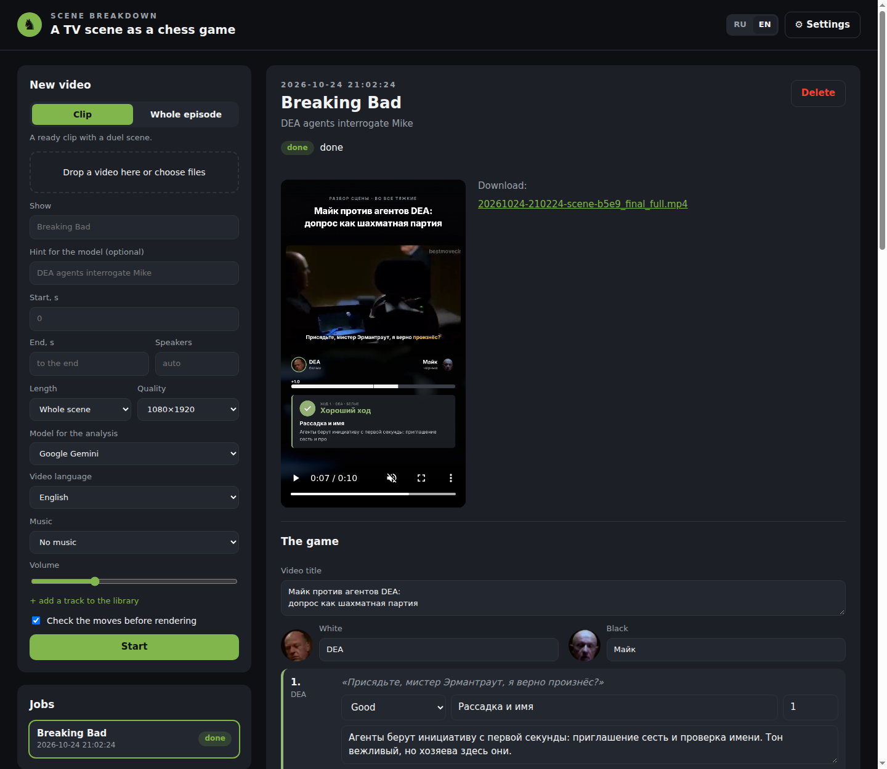
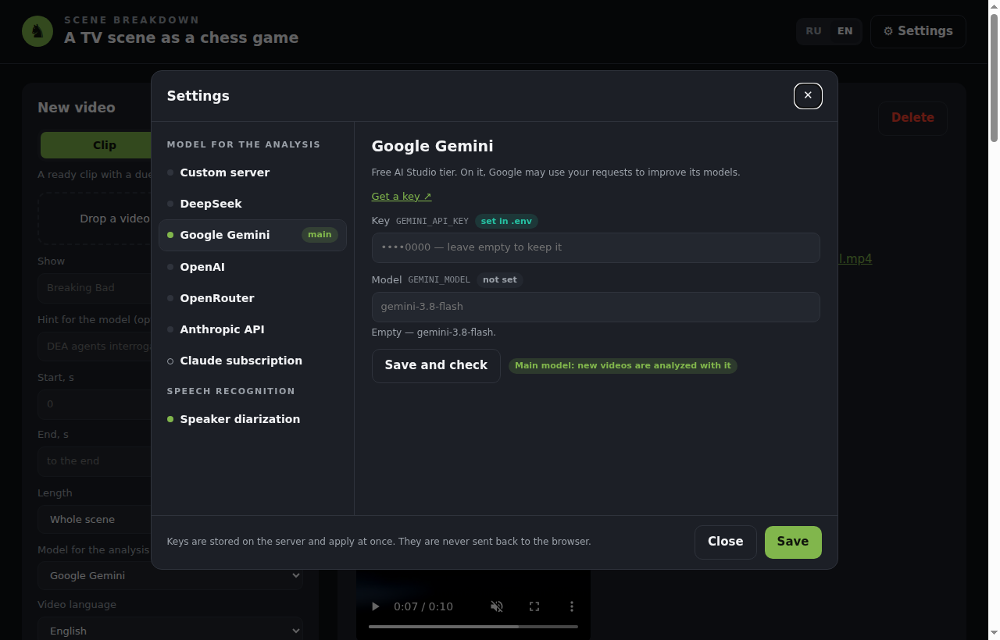

<div align="center">

**English** · [Русский](README.ru.md)

# ♞ Chessify

**A TV-show scene as a chess game**

Upload a clip from a TV show and get a vertical video where every line of the characters
is analyzed like a chess move, with a rating, a comment and an advantage bar.


<sub>An example video for a Russian-dubbed scene. Videos can be made in English too.</sub>

</div>

---

## What it is

Chessify turns a dialogue from a film or a TV show into a chess game breakdown, in the style of
game reviews on Chess.com. You upload a video, and the app does the rest:

- **recognizes the speech** of the characters and works out who is arguing with whom: White vs Black;
- **splits the dialogue into moves** and rates each one: *Brilliant*, *Best*, *Excellent*, *Good*,
  *Inaccuracy*, *Mistake*, *Blunder*;
- **writes a title and a comment** for every move, mixing chess metaphors with psychology;
- **keeps an advantage bar** like a chess engine, and can announce mate in N moves in the finale;
- **sums up the game**: each side's accuracy, how many brilliant moves and mistakes there were, the verdict;
- **builds a ready vertical video** in 1080×1920 for Shorts, Reels and TikTok, with subtitles,
  move cards, a typing sound and background music.

Before the video is built, you can review the analysis and change the rating, title or comment
of any move.

## Features

| | What it does |
|---|---|
| 🎬 **A clip or a whole episode** | Upload a ready scene or a whole episode: the app finds the sharpest dialogues and lets you pick one |
| ✍️ **Review before building** | All moves, ratings and comments can be edited |
| ⏱️ **Video length** | The whole scene, up to 3 minutes, up to 90 or 60 seconds; short versions keep the brightest moves |
| 💬 **Karaoke subtitles** | Each word lights up as it is spoken |
| 🎵 **Background music** | Your own track library: quieter under speech, louder on the cards |
| 📦 **Several videos at once** | Drop several files and they are processed one by one |
| 🧠 **Choice of AI model** | Free and paid AI models, or your own server, switched in the settings |
| 🌍 **Two languages** | The interface and the videos themselves in English or Russian: speech, comments and on-screen text |

## How it looks

Everything happens on one page in the browser: a new video and the job list on the left, the selected
job with a player, the move editor and a rebuild button on the right.



## System requirements

| | Minimum | Recommended |
|---|---|---|
| **System** | Windows 10 (22H2) or 11, 64-bit; or Linux | Windows 11 |
| **Graphics card** | optional — works without one, but noticeably slower | NVIDIA GeForce RTX with 8 GB of memory and a recent driver |
| **Memory (RAM)** | 16 GB | 32 GB |
| **Disk space** | 25 GB free | SSD |
| **Internet** | needed for installation and for a cloud AI model | — |
| **Software** | [Docker Desktop](https://www.docker.com/products/docker-desktop/) | — |

> macOS is not supported yet.

## Installation

You do this once.

1. **Update your graphics driver** if you have an NVIDIA card: through GeForce Experience / the NVIDIA App
    or from the NVIDIA website.
2. **Install [Docker Desktop](https://www.docker.com/products/docker-desktop/)** and start it.
    Keep WSL 2 enabled during installation; it is the default.
3. **Download Chessify**: on this page, click **Code → Download ZIP** and unpack the archive
    into a folder with a short path without spaces or non-Latin letters, e.g. `C:\chessify`.
4. **Start the app**: open that folder in File Explorer, right-click an empty space
    → **Open in Terminal** and run:

    ```powershell
    docker compose up -d --build
    ```

    The first start takes a while: everything needed is downloaded, several gigabytes. Later starts take seconds.

    No NVIDIA graphics card? Use this command instead:
    `docker compose -f compose.yaml -f compose.cpu.yaml up -d --build`

5. **Open** **http://localhost:37415** **in your browser**

The app will start on its own together with Docker Desktop. To stop it, run `docker compose down`
in the same folder.

## First start: choose an AI model

A language model analyzes the game, and it needs access. Click **⚙ Settings** in the top right corner.
Next to it is the interface language switch, **RU / EN**.



1. On the left, under **Model for the analysis**, pick one of the models, enter its key on the right and click
    **Save and check**. If the check passes, click **Make it the main one**.
2. Optionally, open **Speaker diarization**: a free Hugging Face token helps tell more precisely
    which character is speaking. Everything works without it; the sides of the dialogue are then guessed
    from the meaning of the lines.

A green dot next to a section means it is set up. Keys are stored only on your computer.

### Which model to choose

| Model | Cost | When it fits |
|---|---|---|
| **Google Gemini** | free | you want to try without paying. On the free tier, Google may use your requests to improve its models |
| **DeepSeek** | a few cents per video | good quality for little money |
| **OpenAI**, **Anthropic API**, **OpenRouter** | from a few cents to a dollar per video | you already have a key for one of these services |
| **Claude subscription** | included in your Claude plan | you have a Claude Pro/Max subscription; sign in once from a terminal: `docker compose exec app claude`, then `/login` |
| **Custom server** | free if the server is yours | you have access to a deployed model with an OpenAI-compatible address (vLLM, Ollama, LM Studio, etc.) |

Every section in the settings has a **Get a key** link.

## How to make a video

1. **Upload a video**: drop a file into the **New video** form. `.mp4`, `.mkv`, `.mov` and other formats work.
    - **Clip**: if the scene is already cut out.
    - **Whole episode**: the app finds duel scenes and lets you pick one.
2. **Enter the show's name**: it helps the model recognize the characters and spell their names right.
    You can add a hint, e.g. "DEA agents interrogate Mike".
3. **Choose the video language, length, quality and music** and click **Start**.
    The video language is the language spoken in the video; the model writes its comments
    and the on-screen text in the same language.
4. **Review the game.** When the analysis is ready, the editor opens on the right: move categories,
    titles and comments, the video title and the verdict. Change anything you like and click
    **Save and build the video**.
5. **Download the video**: it appears in the player on the right and in the `data\out` folder
    inside the app folder.

Don't want to review anything? Uncheck **Check the moves before rendering**, and the video is built right away.

### Handy editor buttons

- **Recompute the bar from categories**: after you change ratings, the bar and the mate countdown update.
- **Pace the cards**: move cards appear at the start as a hook and then about once every 12 seconds,
  so viewers get to watch the scene rather than only the stops.
- The **Show the card** checkbox on a move removes or restores the stop on that move.

## FAQ

<details>
<summary><b>The page doesn't open</b></summary>

Wait a minute after starting: the app doesn't start instantly. Make sure Docker Desktop is running.
If port 37415 is taken by another program, create a `.env` file in the app folder with the line
`CHESSIFY_PORT=37416` (or any other free number), run `docker compose up -d`
and open `http://localhost:37416`.
</details>

<details>
<summary><b>Why does the first video take so long?</b></summary>

On the first run, the speech recognition models are downloaded, about 3 GB. After that they are loaded from disk.
Without an NVIDIA graphics card, recognition and rendering run on the CPU and take several times longer.
</details>

<details>
<summary><b>"Keys are missing" error</b></summary>

The selected model has no key. Open **⚙ Settings**, enter the key and check the connection,
or pick another model in the **Model for the analysis** field.
</details>

<details>
<summary><b>A character's name is recognized wrong</b></summary>

Enter the show's name and a hint when uploading: the model uses them to fix names. If a mistake remains,
correct the card text in the editor before building the video.
</details>

<details>
<summary><b>Where are my videos and settings?</b></summary>

In the app folder, under `data`: finished videos in `data\out`, music in `data\music`, keys in `data\settings`.
Don't delete this folder when you update the app.
</details>

<details>
<summary><b>Can I open the app from my phone?</b></summary>

Yes, if the phone is on the same network: `http://<computer address>:37415`. The `ipconfig` command shows
the computer's address (the "IPv4 Address" line). The app has no password, so don't expose it to the internet.
</details>

## Updating

Download the new version and unpack it over the old one (leave the `data` folder alone), then run
`docker compose up -d --build` in the app folder.

## Copyright

TV-show clips and music belong to their rights holders. When publishing videos, follow the platforms'
rules and copyright law: automation doesn't remove responsibility for the material you use.

---

<div align="center">
<sub>For developers — architecture, model profiles and the command line: <a href="docs/development.md">docs/development.md</a></sub>
</div>
