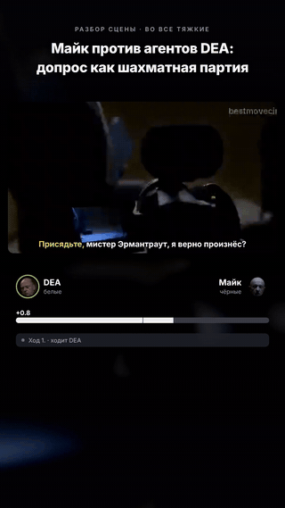
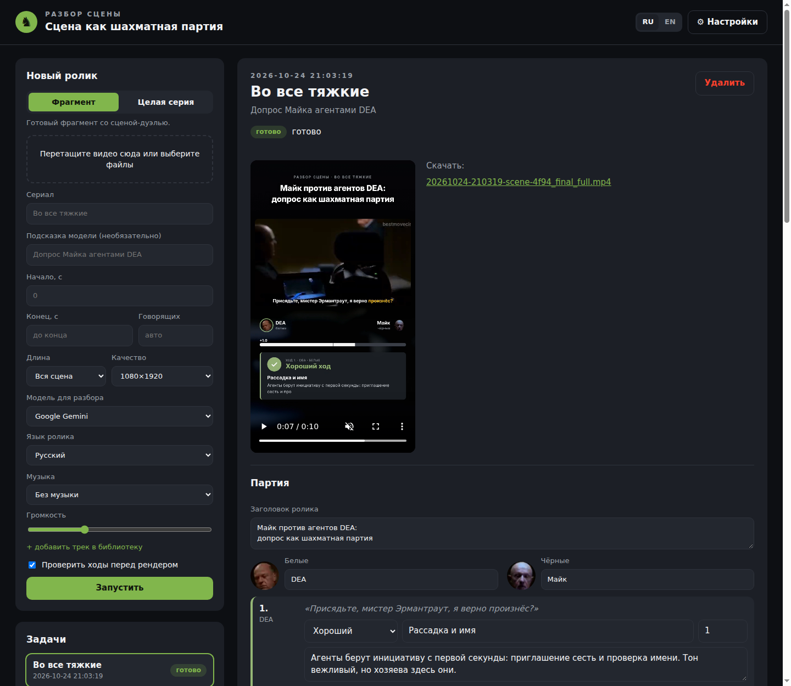
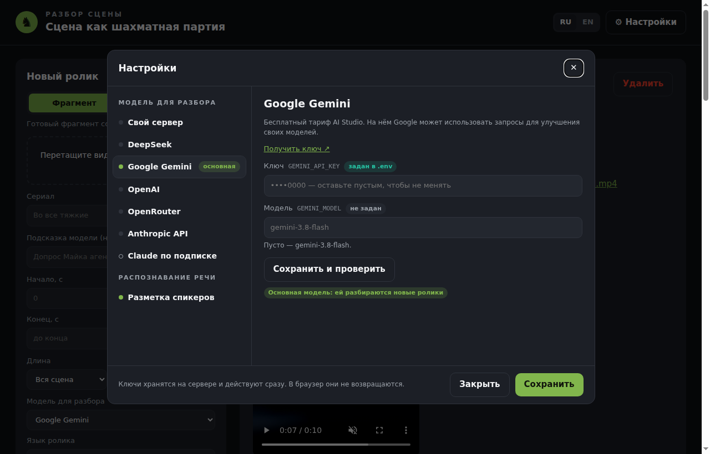

<div align="center">

[English](README.md) · **Русский**

# ♞ Chessify

**Сцена из сериала как шахматная партия**

Загрузите фрагмент сериала — получите вертикальный ролик, где каждая реплика героев
разобрана как ход в шахматах: с оценкой, комментарием и шкалой преимущества.



</div>

---

## Что это

Chessify превращает диалог из фильма или сериала в разбор шахматной партии — в стиле анализа
партий на Chess.com. Вы загружаете видео, а приложение само:

- **распознаёт речь** героев и понимает, кто с кем спорит — «белые» против «чёрных»;
- **делит диалог на ходы** и оценивает каждый: *Блестящий*, *Лучший*, *Отличный*, *Хороший*,
  *Неточность*, *Ошибка*, *Зевок*;
- **придумывает название и комментарий** к каждому ходу — с шахматными метафорами и психологией;
- **ведёт шкалу преимущества**, как шахматный движок, а в развязке может объявить мат в N ходов;
- **подводит итоги партии**: точность каждой стороны, сколько было блестящих ходов и ошибок, вердикт;
- **собирает готовый вертикальный ролик** 1080×1920 для Shorts, Reels и TikTok — с субтитрами,
  карточками ходов, звуком печати и фоновой музыкой.

Перед сборкой ролика разбор можно проверить и поправить: поменять оценку, название или комментарий
любого хода.

## Возможности

| | Что умеет |
|---|---|
| 🎬 **Фрагмент или целая серия** | Загрузите готовую сцену — или серию целиком: приложение само найдёт самые острые диалоги и предложит выбрать |
| ✍️ **Проверка перед сборкой** | Все ходы, оценки и комментарии можно поправить в редакторе |
| ⏱️ **Длина ролика** | Вся сцена, до 3 минут, до 90 или до 60 секунд — для коротких версий выбираются самые яркие ходы |
| 💬 **Караоке-субтитры** | Слово подсвечивается в момент, когда его произносят |
| 🎵 **Фоновая музыка** | Своя библиотека треков: под речью музыка тише, на карточках — громче |
| 📦 **Несколько видео сразу** | Перетащите несколько файлов — они обработаются по очереди |
| 🧠 **Модель на выбор** | Бесплатные и платные модели ИИ, а также свой сервер — переключаются в настройках |
| 🌍 **Два языка** | Интерфейс и сами ролики — на русском или английском: речь, комментарии и надписи в ролике |

## Как это выглядит

Всё управление — на одной странице в браузере: слева новый ролик и список задач, справа — выбранная
задача с плеером, редактором ходов и кнопкой пересборки.



## Системные требования

| | Минимум | Рекомендуется |
|---|---|---|
| **Система** | Windows 10 (22H2) или 11, 64-бит; или Linux | Windows 11 |
| **Видеокарта** | не обязательна — без неё работает, но заметно медленнее | NVIDIA GeForce RTX с 8 ГБ памяти и свежим драйвером |
| **Оперативная память** | 16 ГБ | 32 ГБ |
| **Место на диске** | 25 ГБ свободного места | SSD |
| **Интернет** | нужен при установке и для облачной модели ИИ | — |
| **Программы** | [Docker Desktop](https://www.docker.com/products/docker-desktop/) | — |

> macOS пока не поддерживается.

## Установка

Делается один раз.

1. **Обновите драйвер видеокарты** NVIDIA (если она есть) — через GeForce Experience / NVIDIA App
    или с сайта NVIDIA.
2. **Установите [Docker Desktop](https://www.docker.com/products/docker-desktop/)** и запустите его.
    При установке оставьте включённым WSL 2 — так предлагается по умолчанию.
3. **Скачайте Chessify**: на этой странице нажмите **Code → Download ZIP** и распакуйте архив
    в папку с коротким путём без русских букв, например `C:\chessify`.
4. **Запустите приложение**: откройте эту папку в Проводнике, щёлкните правой кнопкой по пустому месту
    → **Открыть в терминале** и выполните:

    ```powershell
    docker compose up -d --build
    ```

    Первый запуск долгий — скачивается всё нужное, это несколько гигабайт. Следующие запуски — секунды.

    Компьютер без видеокарты NVIDIA? Тогда команда такая:
    `docker compose -f compose.yaml -f compose.cpu.yaml up -d --build`

5. **Откройте в браузере** **http://localhost:37415**

Приложение будет запускаться само вместе с Docker Desktop. Остановить его — `docker compose down`
в той же папке.

## Первый запуск: выберите модель ИИ

Разбирает партию языковая модель — ей нужен доступ. Нажмите **⚙ Настройки** справа вверху. Там же, рядом, переключатель языка интерфейса **RU / EN**.



1. Слева в разделе **«Модель для разбора»** выберите одну из моделей, справа впишите ключ и нажмите
    **«Сохранить и проверить»**. Если проверка прошла — **«Сделать основной»**.
2. По желанию — раздел **«Разметка спикеров»**: бесплатный токен Hugging Face помогает точнее понять,
    кто из героев говорит. Без него всё работает, просто стороны диалога определяются по смыслу реплик.

Зелёная точка у раздела — всё настроено. Ключи хранятся только на вашем компьютере.

### Какую модель выбрать

| Модель | Стоимость | Когда подходит |
|---|---|---|
| **Google Gemini** | бесплатно | хочется попробовать, не платя. На бесплатном тарифе Google может использовать запросы для улучшения своих моделей |
| **DeepSeek** | несколько центов за ролик | хорошее качество за небольшие деньги |
| **OpenAI**, **Anthropic API**, **OpenRouter** | от нескольких центов до доллара за ролик | уже есть ключ одного из этих сервисов |
| **Claude по подписке** | входит в подписку Claude | есть подписка Claude Pro/Max — вход один раз из терминала: `docker compose exec app claude`, затем `/login` |
| **Свой сервер** | бесплатно, если сервер ваш | у вас есть доступ к развёрнутой модели с OpenAI-совместимым адресом (vLLM, Ollama, LM Studio и т. п.) |

Ссылка «Получить ключ» есть в каждом разделе настроек.

## Как сделать ролик

1. **Загрузите видео** — перетащите файл в форму «Новый ролик». Подойдёт `.mp4`, `.mkv`, `.mov` и другие.
    - **Фрагмент** — если сцена уже вырезана.
    - **Целая серия** — приложение найдёт сцены-дуэли и предложит выбрать одну.
2. **Укажите сериал** — это помогает модели узнать героев и правильно писать их имена.
    Можно добавить подсказку, например «Допрос Майка агентами DEA».
3. **Выберите язык ролика, длину, качество и музыку** и нажмите **«Запустить»**.
    Язык ролика — это язык речи в видео: на нём же модель пишет комментарии и выводятся надписи.
4. **Проверьте партию.** Когда разбор готов, справа откроется редактор: категории, названия
    и комментарии ходов, заголовок ролика и итог. Поправьте, что хочется, и нажмите
    **«Сохранить и собрать ролик»**.
5. **Скачайте ролик** — он появится в плеере справа, а также в папке `data\out` внутри папки приложения.

Не хотите ничего проверять — снимите галочку «Проверить ходы перед рендером», и ролик соберётся сразу.

### Полезные кнопки редактора

- **«Пересчитать шкалу по категориям»** — после правки оценок шкала и отсчёт до мата обновятся сами.
- **«Расставить карточки по темпу»** — карточки ходов появятся в начале как крючок, а дальше примерно
  раз в 12 секунд: зритель успевает посмотреть сцену, а не только остановки.
- Галочка **«Показывать карточку»** у хода — убрать или вернуть остановку на конкретном ходе.

## Частые вопросы

<details>
<summary><b>Страница не открывается</b></summary>

Подождите минуту после запуска — приложение стартует не мгновенно. Проверьте, что Docker Desktop запущен.
Если порт 37415 занят другой программой, создайте в папке приложения файл `.env` со строкой
`CHESSIFY_PORT=37416` (или любой другой свободный номер), выполните `docker compose up -d`
и откройте `http://localhost:37416`.
</details>

<details>
<summary><b>Почему первый ролик делается так долго?</b></summary>

При первом запуске скачиваются модели распознавания речи — около 3 ГБ. Дальше они берутся с диска.
Без видеокарты NVIDIA распознавание и сборка ролика идут на процессоре и занимают в несколько раз дольше.
</details>

<details>
<summary><b>Ошибка «не хватает ключей»</b></summary>

У выбранной модели не задан ключ. Откройте **⚙ Настройки**, впишите ключ и проверьте подключение —
или выберите другую модель в поле «Модель для разбора».
</details>

<details>
<summary><b>Неправильно распознано имя героя</b></summary>

Укажите сериал и подсказку при загрузке — по ним модель исправляет имена. А если ошибка осталась,
поправьте текст карточки в редакторе перед сборкой.
</details>

<details>
<summary><b>Где лежат мои ролики и настройки?</b></summary>

В папке приложения, в `data`: готовые ролики — `data\out`, музыка — `data\music`, ключи — `data\settings`.
При обновлении приложения эту папку не удаляйте.
</details>

<details>
<summary><b>Можно ли открыть приложение с телефона?</b></summary>

Да, если телефон в той же сети: `http://<адрес компьютера>:37415`. Адрес компьютера покажет команда
`ipconfig` (строка «IPv4-адрес»). У приложения нет пароля — не открывайте его в интернет.
</details>

## Обновление

Скачайте новую версию и распакуйте её поверх старой (папку `data` не трогайте), затем в папке
приложения выполните `docker compose up -d --build`.

## Об авторских правах

Фрагменты сериалов и музыка принадлежат их правообладателям. Публикуя ролики, учитывайте правила
площадок и законы об авторском праве: автоматизация не снимает ответственности за использованный материал.

---

<div align="center">
<sub>Разработчикам — устройство, профили моделей и командная строка: <a href="docs/development.ru.md">docs/development.ru.md</a></sub>
</div>
